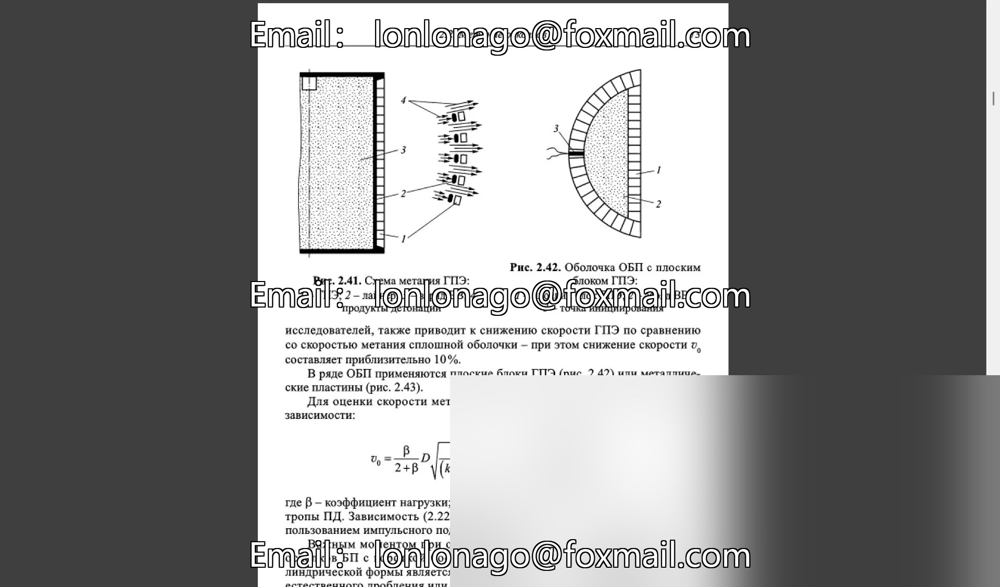
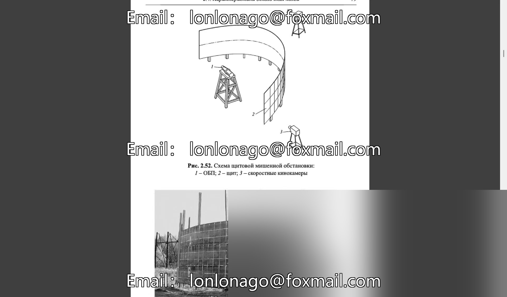
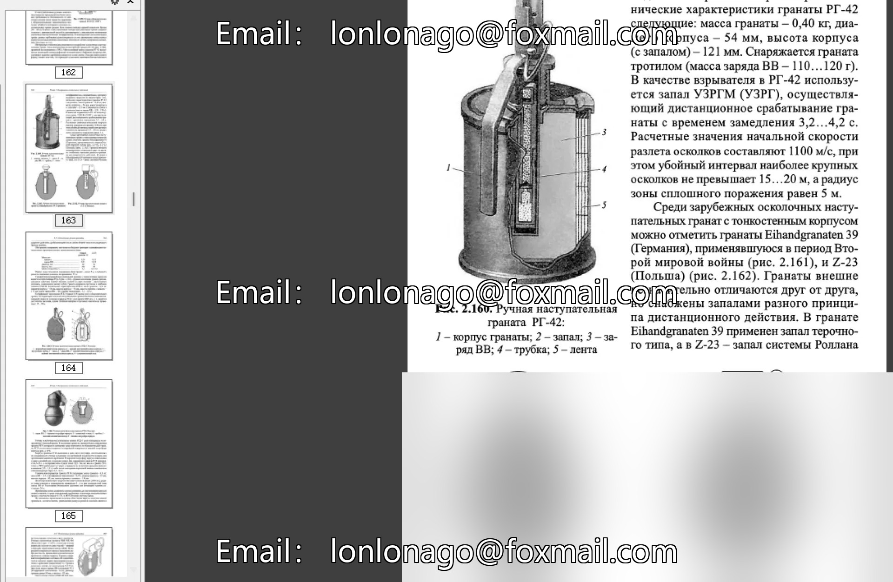
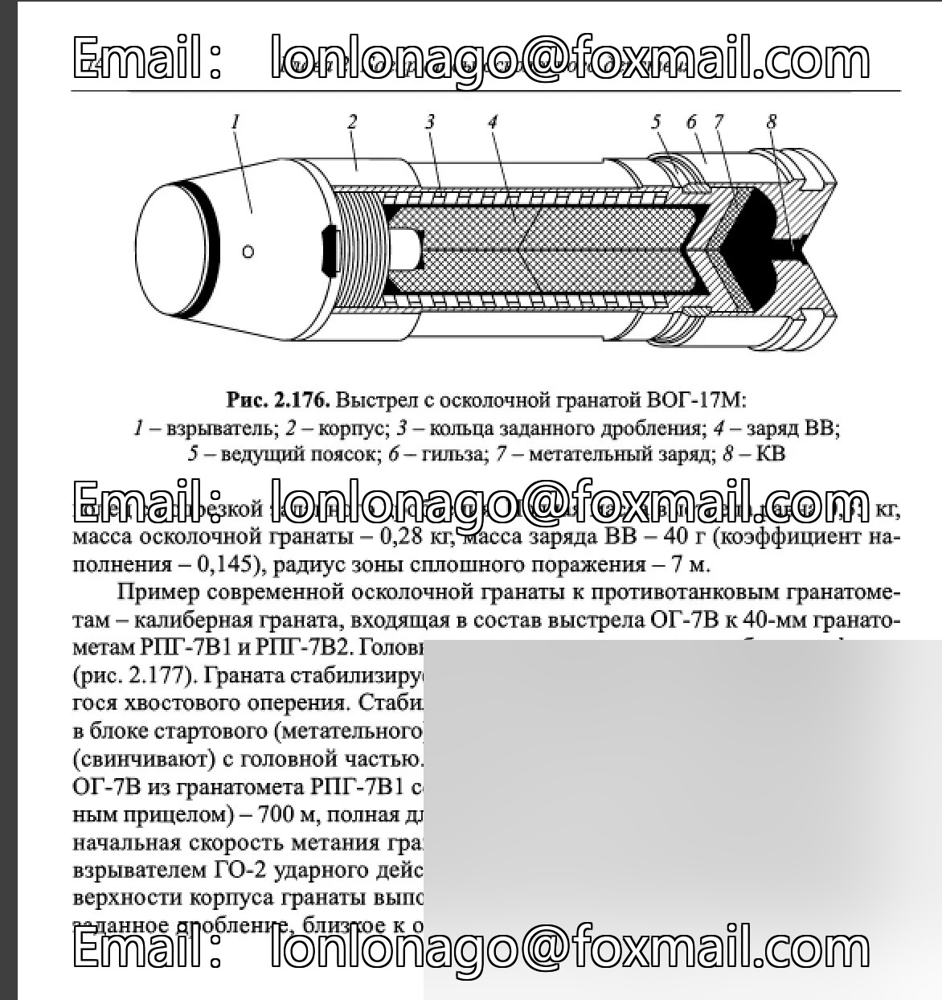

# Fightning weapon physical technology

## Body

Súngilla weapon physical technology 《Súngilla Weapons and Ammo: Physics, Technology, and Process》 Volume 1-2
Total approximately 1000 pages
This book belongs to high-specialized textbooks or monographs in the ammunition engineering and technology field.

Physics: Involves basic scientific principles such as end effects of munitions, explosion mechanics, penetrating material physics, and fragmentation distribution.
Technology: Covers engineering techniques and performance analysis of munitions design and various systems (such as fuses, warheads, propellants).
Process: Includes manufacturing processes such as materials, processing, assembly, and testing of munitions.
Electronic data, copyable, no return if sold.

This is a textbook or monograph in physical technology for lethal weapons, covering physics of munitions, technology and manufacturing processes and is approximately 1,000 pages.

<!-- AI_ENRICHED -->

## Images

## Payment

Here is a pay link on Stripe ( https://buy.stripe.com/3cs8yP7sY87d0vu9AB ). Please contact me lonlonago@foxmail.com after funding $89, and I will send you a complete data files , thank you!

